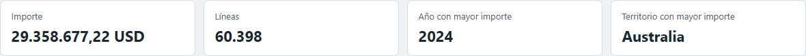
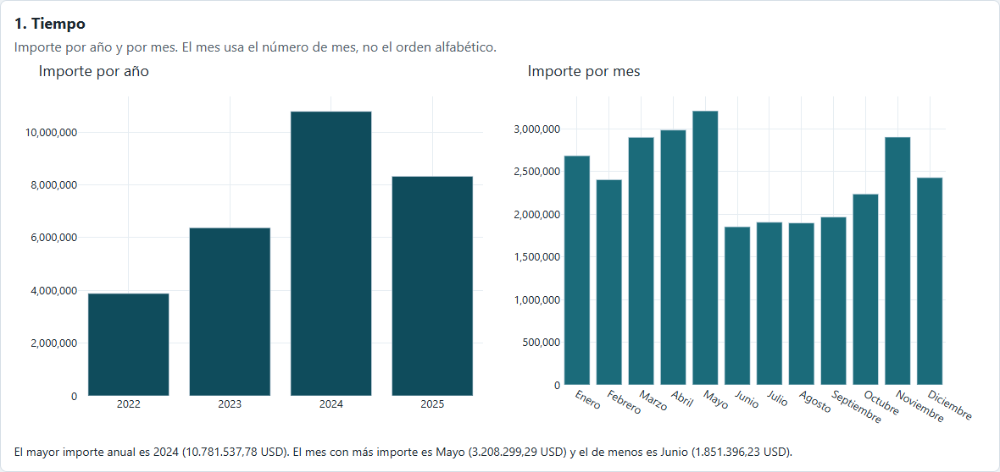
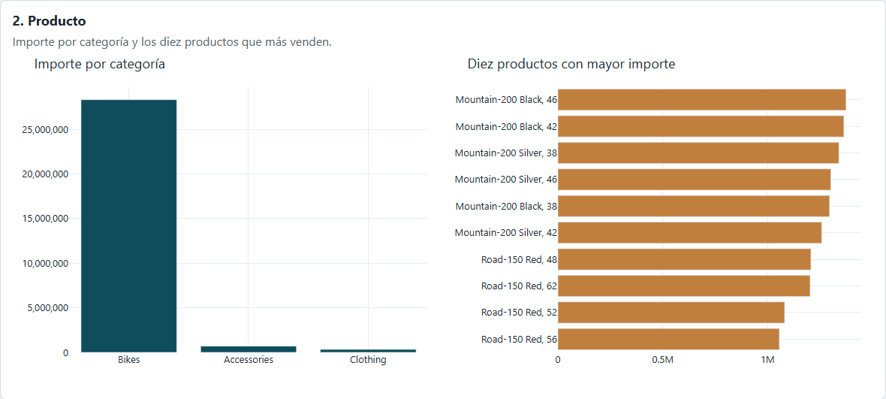
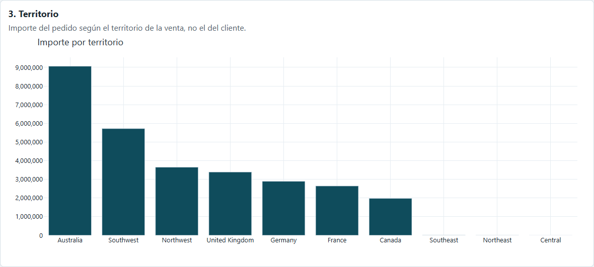
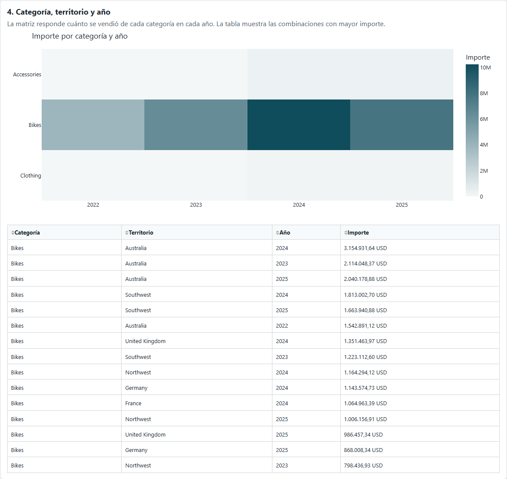

# De AdventureWorks al informe de ventas por internet

Este trabajo pasa de la base de AdventureWorks, donde se registran los pedidos, a un informe en Plotly Dash. En medio hay un data warehouse con esquema en estrella y un ETL en Python que lo carga.

La pregunta de la asignatura es:

> ¿Cuál es el importe de las ventas por categoría de producto, territorio y año?

El informe se queda con las ventas por internet y enseña el importe en cuatro partes: tiempo, producto, territorio, y la combinación de categoría, territorio y año.

No se calcula margen, ni flete, ni impuesto, ni se analizan clientes. Más abajo se explica por qué.

## Dos totales que no se pueden mezclar

El almacén guarda todas las ventas. El informe solo enseña internet. Los dos números son correctos, pero no responden lo mismo.

- Todo el almacén: 121.317 líneas y 109.846.381,4250 USD.
- Solo internet, que es lo que sale en el dashboard: 60.398 líneas y 29.358.677,22 USD.

Si en la defensa se citan 109 millones como venta por internet, la cifra está mal.

## Requisitos

Antes de Python hacen falta tres programas.

**SQL Server Express.** Es el motor de base de datos. La instancia de este trabajo es `localhost\SQLEXPRESS`. Ahí conviven las dos bases: `AdventureWorks2025`, que es el OLTP, y `AdventureWorks_DWH`, que es el almacén. Express es la edición gratuita y con este volumen sobra.

**SQL Server Management Studio.** Es el programa donde se abren los scripts de la carpeta `sql` y se ejecutan con F5: crear las tablas, la vista de internet y las comprobaciones. Sin SSMS se puede usar Azure Data Studio, pero los scripts están pensados para una consulta nueva de Management Studio.

**ODBC.** Es el puente entre Python y SQL Server. Tiene que estar instalado *ODBC Driver 17 for SQL Server* o *ODBC Driver 18 for SQL Server*. La librería `pyodbc` lo usa en el ETL y en el dashboard, con autenticación de Windows. Si ese controlador no está, Python no llega al servidor.

Las librerías de Python están en `requirements.txt`: `pandas`, `pyodbc`, `dash` y `plotly`. Se instalan con `pip install -r requirements.txt`.

## Cómo está montado

Se trabaja en SQL Server Express, instancia `localhost\SQLEXPRESS`, con autenticación de Windows.

- OLTP: `AdventureWorks2025`. Guarda los pedidos tal como se hacen.
- Data warehouse: `AdventureWorks_DWH`. Guarda los datos ya preparados para analizar.
- ETL: `etl/load_dwh.py`. Pasa los datos de una base a la otra.
- Vista de internet: `vw_FactInternetSales`. Se queda solo con el canal internet.
- Dashboard: `dashboard.py`. Muestra los cuatro bloques.

El dashboard no lee el OLTP. Lee el almacén. Así no hay que unir las tablas del pedido cada vez que se mueve un filtro.

## 1. El OLTP

OLTP significa *Online Transaction Processing*. Es la base del día a día. En AdventureWorks está normalizada: cada dato está en su tabla para poder registrar el pedido sin repetir información.

Eso va bien para guardar una venta y mal para un informe, porque una sola línea está partida:

- Unidades, precio, descuento e importe: `Sales.SalesOrderDetail`
- Fecha, cliente, territorio y número de pedido: `Sales.SalesOrderHeader`
- Nombre del producto: `Production.Product`
- Subcategoría: `Production.ProductSubcategory`
- Categoría: `Production.ProductCategory`
- Territorio: `Sales.SalesTerritory`
- Nombre de la persona o de la tienda: `Person.Person` o `Sales.Store`

Antes de cargar nada se comprobó que el origen estaba completo:

- Líneas de pedido: 121.317
- Pedidos: 31.465
- Clientes: 19.820
- Clientes con persona: 19.119
- Clientes que solo son tienda: 701

19.119 + 701 = 19.820. Esas cifras son de toda la base, no del informe de internet.

## 2. El esquema en estrella

El modelo sigue a Kimball. En el centro está `Fact_Sales`, que es la que se suma. Alrededor están las dimensiones: cuándo, qué, quién y dónde.

```text
                 Dim_Date
                    |
Dim_Product ---- Fact_Sales ---- Dim_Customer
                    |
              Dim_Territory
```

Se creó otra base, `AdventureWorks_DWH`, para no mezclar el informe con las tablas de los pedidos.

### El grano

El grano es lo que significa una fila. Se fijó antes de crear las tablas: una fila de `Fact_Sales` es una línea de `Sales.SalesOrderDetail`.

Si la fila fuera el pedido entero, un pedido con tres productos contaría como uno y se perdería la categoría de cada producto. Con la línea se puede sumar por categoría, por territorio y por año.

Por ese mismo grano se dejaron fuera el flete y el impuesto. `Freight` y `TaxAmt` están en la cabecera del pedido. Si se copiaran en cada línea, un flete de 10 USD en un pedido de cuatro productos contaría como 40. Por eso no están en `Fact_Sales`.

### Las tablas

- `Fact_Sales`: importe y unidades. Sale de la línea de detalle, más la fecha, el cliente y el territorio de la cabecera.
- `Dim_Date`: la fecha. No sale de una tabla del OLTP. Se genera, un día por fila.
- `Dim_Product`: producto, categoría y subcategoría. Sale de `Product`, `ProductSubcategory` y `ProductCategory`.
- `Dim_Customer`: persona o tienda. Sale de `Customer`, `Person` y `Store`.
- `Dim_Territory`: territorio del pedido. Sale de `SalesOrderHeader`.

`Dim_Customer` está cargada, pero este dashboard no la usa. La pregunta no es quién compró.

### Clave de negocio y clave subrogada

Cada producto, cliente y territorio tiene dos claves.

La clave de negocio es la del OLTP: `ProductID`, `CustomerID`, `TerritoryID`. En el almacén se guarda como `ProductAlternateKey`, `CustomerAlternateKey` y `TerritoryAlternateKey`. Sirve para saber de qué registro viene y para actualizarlo si cambia el nombre.

La clave subrogada es un entero nuevo: `ProductKey`, `CustomerKey`, `TerritoryKey`. La crea SQL Server con `IDENTITY(1,1)`. Python no la inventa. `Fact_Sales` guarda esta clave, no la del OLTP. Si más adelante cambia el identificador en AdventureWorks, las ventas viejas siguen apuntando al mismo sitio.

`DateKey` no es un contador. Es la fecha en formato `AAAAMMDD`. El 3 de mayo de 2013 es `20130503`. Así la fecha del pedido y `Dim_Date` usan el mismo número.

### Las medidas

- `OrderQty`: unidades de la línea.
- `UnitPrice`: precio unitario.
- `DiscountPct`: descuento. En origen se llama `UnitPriceDiscount`.
- `SalesAmount`: importe de la línea. En origen es `LineTotal`.

`SalesAmount` es un `DECIMAL(19,4)`. `LineTotal` tiene más decimales, así que en la carga y en la comprobación se redondea con `CAST(LineTotal AS decimal(19,4))`. Si no, las sumas no cuadran por los céntimos.

`SalesOrderDetailID` es único. Con eso la misma línea no se carga dos veces.

### Decisiones del modelo

El territorio es el del pedido. El cliente tiene un territorio y el pedido tiene otro. Se usó el de `SalesOrderHeader.TerritoryID`, porque la pregunta es dónde se vendió, no dónde está fichado el cliente.

La categoría va dentro del producto. En el OLTP está en otra tabla. En `Dim_Product` ya viene `CategoryName` y `SubcategoryName`. Si falta el color, la subcategoría o la categoría, se pone `Desconocido` para que la línea no desaparezca del informe.

La fecha se genera. `Dim_Date` va desde el primer pedido hasta un año después del último. Son 1.492 días. Cada fila tiene año, trimestre, mes, nombre del mes y día de la semana.

También se calculó el año fiscal. En AdventureWorks empieza el 1 de julio. De julio a diciembre, el año fiscal es el año normal más uno. De enero a junio, coinciden. En el dashboard se usa `CalendarYear`, el año normal, porque la pregunta dice «año». Si se mezclaran los dos, el gráfico diría otra cosa.

No se metió el coste. El coste que hay hoy en el producto no es el coste de una venta de hace años. Para el margen haría falta `ProductCostHistory`, el coste de aquella fecha. Como no se hizo, no se habla de rentabilidad.

## 3. El ETL

ETL es *Extract, Transform, Load*: sacar los datos, transformarlos y cargarlos. El script es `etl/load_dwh.py`.

El orden no da igual. Primero se cargan las dimensiones, porque `Fact_Sales` necesita sus claves. Después se carga `Fact_Sales`.

```text
OLTP  ->  consulta SQL (ya unida)  ->  Pandas (limpieza)
      ->  tablas stg_  ->  MERGE a las dimensiones
      ->  Fact_Sales  ->  comprobación
```

### Sacar los datos ya unidos

Los `JOIN` se hacen en SQL Server. Pandas no vuelve a unir producto, subcategoría y categoría. Eso lo haría peor y podría duplicar filas.

Pandas limpia: los nulos y los textos vacíos pasan a `Desconocido`. También decide el tipo de cliente. Si tiene persona, el tipo es `Person` y el nombre es nombre y apellido. Si no, el tipo es `Store` y el nombre es el de la tienda.

Los importes se convierten a decimal en la consulta. No se pasan por un float de Python, porque se pierden céntimos.

### Crear el calendario

Se lee la fecha mínima y la máxima de los pedidos y se genera un día por fila, con el año normal y el año fiscal.

### Cargar las dimensiones

Cada dimensión entra primero en una tabla de etapa: `stg_Date`, `stg_Product`, `stg_Customer`, `stg_Territory`. Ahí está el dato preparado, todavía sin ser la dimensión final.

Luego se usa `MERGE`. Busca por la clave de negocio:

- Si ya existe, se actualiza el nombre y se deja la misma clave subrogada. Esto es un SCD Tipo 1: se sobreescribe la descripción y las ventas viejas siguen apuntando al mismo registro.
- Si no existe, se inserta y SQL Server asigna la clave.

### Cargar Fact_Sales

En la etapa de `Fact_Sales` todavía están `ProductID`, `CustomerID` y `TerritoryID`. Al insertar en `Fact_Sales` se cambian por `ProductKey`, `CustomerKey` y `TerritoryKey`, uniéndolos con las dimensiones.

Si una línea no encuentra producto, cliente, territorio o fecha, no entra. Luego se nota, porque no saldrían las 121.317 filas.

Antes de insertar se vacía `Fact_Sales`. Por eso se puede ejecutar el ETL otra vez y no se duplican las ventas. Se ejecutó dos veces y los totales salieron iguales.

### Si no cuadra, no se guarda

Va todo en una transacción. Si las líneas o el importe no coinciden con el origen, el script hace rollback y no deja la carga a medias. Si coinciden, hace commit y crea `vw_Sales`, que es `Fact_Sales` unida a las cuatro dimensiones.

## 4. Comprobar que el almacén está bien

- Líneas: 121.317 en origen y 121.317 en el almacén.
- Importe: 109.846.381,4250 en los dos lados.
- Personas: 19.119. Tiendas: 701.
- Productos: 504. Territorios: 10. Fechas: 1.492.

Con esto se sabe que el almacén copió bien el OLTP. Todavía no es el número de internet, porque aquí van los dos canales.

## 5. Separar internet

El canal está en `Sales.SalesOrderHeader.OnlineOrderFlag`. Si vale 1, el pedido es de internet.

- Internet: 60.398 líneas y 29.358.677,2207 USD.
- El resto: 60.919 líneas y 80.487.704,2043 USD.
- Total: 121.317 líneas y 109.846.381,4250 USD.

`Fact_Sales` se queda con los dos. Para el informe se creó la vista `vw_FactInternetSales` (`sql/07_vista_ventas_internet.sql`). Una vista no copia las filas: es una consulta con nombre. Esta devuelve `Fact_Sales` filtrada a internet. El filtro se hace en SQL. El dashboard no vuelve a mirar la cabecera del pedido en cada clic.

```text
Fact_Sales  +  OnlineOrderFlag = 1  ->  vw_FactInternetSales  ->  dashboard
```

No se usa `CustomerType` para separar el canal. Hay 635 clientes que tienen persona y tienda a la vez, y el ETL los marca como `Person` porque tienen `PersonID`. El canal válido es `OnlineOrderFlag`.

En internet, `OrderQty` siempre es 1. Las unidades y las líneas dan el mismo número, así que en el dashboard se enseñan líneas e importe, no las unidades como si fueran otra cosa.

## 6. El dashboard

`dashboard.py` al abrirse hace una consulta: une `vw_FactInternetSales` con `Dim_Date`, `Dim_Product` y `Dim_Territory`. Esas 60.398 filas se quedan en memoria. Los filtros recortan eso y actualizan los gráficos. No vuelven al OLTP.

Si no hay 60.398 líneas, o el importe no es 29.358.677,2207 USD, el programa no arranca. Así no se cuela el total de los dos canales.

```text
python dashboard.py
```

Se abre en `http://127.0.0.1:8050/`. Sin filtros, la primera tarjeta tiene que poner 29.358.677,22 USD.

Los filtros de año, territorio y categoría valen para los cuatro bloques. Si se elige un año, la tarjeta ya no enseña el total de control, enseña el de ese año. Para volver al número de control se dejan los filtros vacíos.

Las capturas de abajo son el dashboard sin ningún filtro.



Arriba se ve el control de la entrega: 29.358.677,22 USD y 60.398 líneas. El año con más importe es 2024 y el territorio con más importe es Australia.

### Tiempo



A la izquierda, el importe de cada año. 2024 es el más alto, con 10.781.537,78 USD. A la derecha, el importe de cada mes, ordenado de enero a diciembre y no por el nombre del mes. Mayo es el mes más alto (3.208.299,29 USD) y junio el más bajo (1.851.396,23 USD).

### Producto



Casi todo el importe está en la categoría Bikes. Accessories y Clothing se ven, pero pesan poco al lado. A la derecha, los diez productos con más importe: las variantes de Mountain-200 van por delante y después aparecen las Road-150.

### Territorio



El territorio es el del pedido. Australia concentra el importe. Detrás van Southwest, Northwest, United Kingdom, Germany, France y Canada. Southeast, Northeast y Central casi no tienen venta por internet, por eso la barra no se aprecia.

### Categoría, territorio y año



La matriz responde la pregunta de la asignatura. En filas está la categoría y en columnas el año. El color oscuro es más importe. La franja de Bikes es la que se ve, y 2024 es el año más oscuro. Accessories y Clothing quedan casi en blanco.

La tabla lista las 15 combinaciones de categoría, territorio y año con más importe. La primera es Bikes, Australia, 2024, con 3.154.931,64 USD. Las siguientes siguen siendo bicicletas: cambia el territorio o el año, no la categoría.

## 7. Lo que quedó fuera

- Margen y coste: el coste de hoy no sirve para una venta antigua.
- Flete e impuesto: están en la cabecera y se repetirían en cada línea.
- Clientes: la dimensión está cargada, pero la pregunta no va de clientes.
- Crecimiento respecto al año anterior: el gráfico enseña el importe por año. No se calculó el porcentaje.
- Año fiscal: está en `Dim_Date`, pero los gráficos usan el año normal.
- El otro canal: sigue en `Fact_Sales`. La vista del dashboard lo quita.

## 8. Para volver a hacerlo

1. `sql/01_verificar_oltp.sql`
2. `sql/02_crear_esquema_estrella.sql`
3. `sql/03_verificar_dwh_vacio.sql` (`Fact_Sales` tiene que estar a 0 antes de la primera carga)
4. `python etl/load_dwh.py`, y otra vez. Las dos veces: 121.317 líneas y 109.846.381,4250 USD
5. `sql/07_vista_ventas_internet.sql`. Tiene que dar 60.398 líneas y 29.358.677,2207 USD
6. `sql/06_verificacion_final.sql`. Las 14 pruebas en OK
7. `python dashboard.py`. Sin filtros, la tarjeta pone 29.358.677,22 USD

Para cerrar: 121.317 líneas y 109.846.381,4250 USD demuestran que el ETL cargó todo. 60.398 líneas y 29.358.677,22 USD son las ventas por internet y el número del informe.
